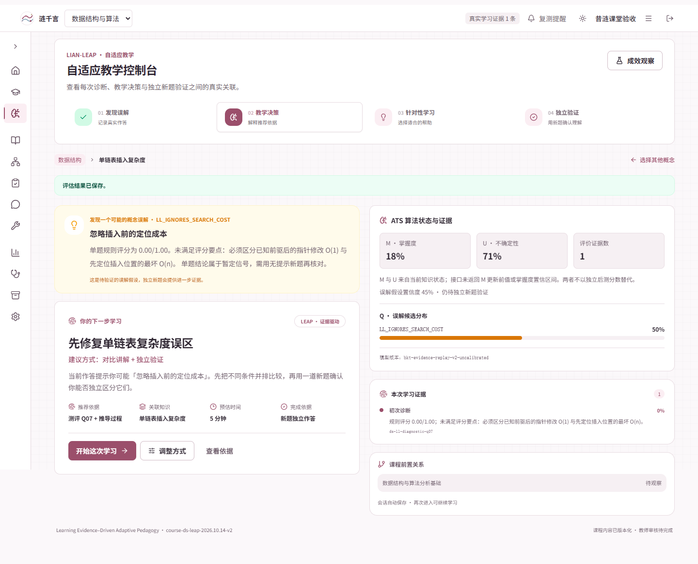
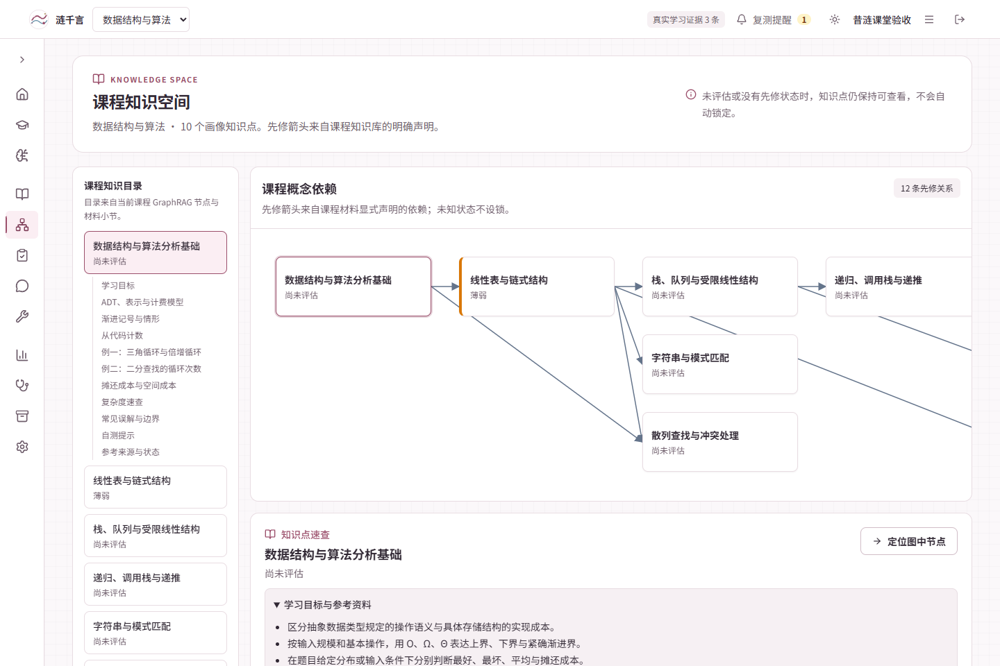
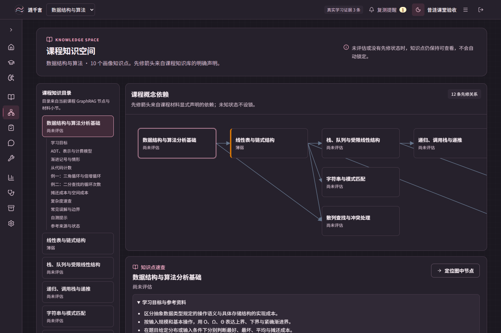
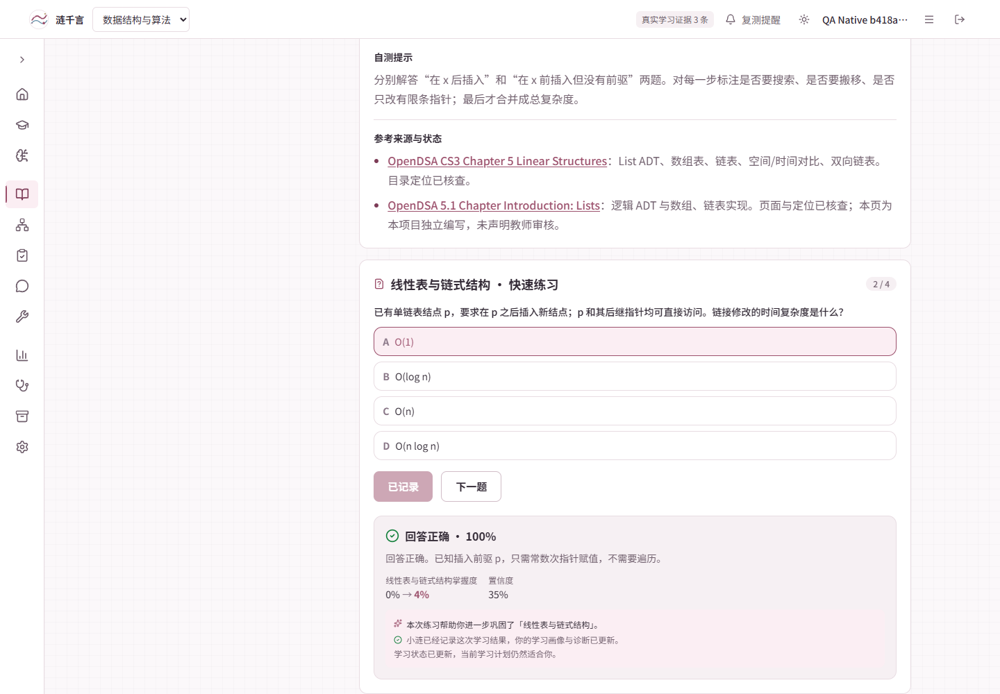
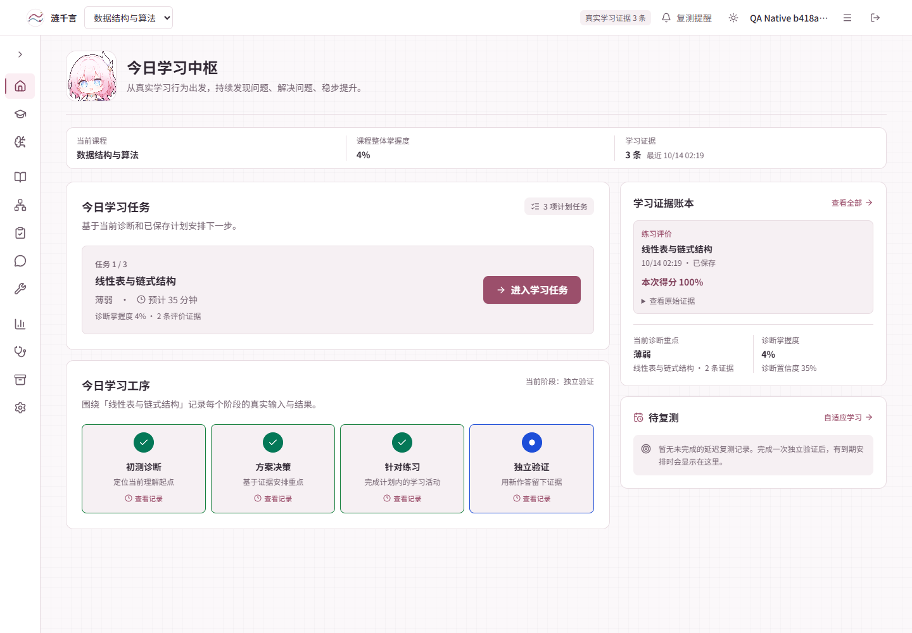

# 2026-10-14 证据、知识库与昔涟界面验收

范围：从 `7cb0adde341c` 收口复审缺陷，保留“按最新 UI 优化文档完成工作”已交付的工作台布局。使用独立本地 SQLite 与临时账号，不修改真实学习者的成绩，不以脚本作答代表教学增益。

## 可复核结果

| 项目 | 本次结果 |
| --- | --- |
| 服务端评分与一次性入账 | 真实 HTTP 正确答案产生证据；同题重试无新计数；伪造 score 返回 422 且无证据写入 |
| 跨入口与闭环 | 原生练习证据进入 LEAP；诊断、教学、练习、独立 probe、会话/overview 重载通过 |
| 课程知识 | 10 个主点、42 个目标、10 篇材料、80 道分阶段客观题；课程图覆盖全部知识点 |
| 原生工作台补验 | 生产构建 Chrome 实际生成计划、进入任务、评分、刷新同题恢复选项/分数，刷新无重复POST或证据写入 |
| 学习体验 | 实际选课；恢复已答结果；后测保存与规划状态分开；不可比成绩不计算增益 |
| 浏览器 | Chrome 1440×960、390×844；注册到独立后测及退出登录恢复；22 项断言通过，无应用异常/页面横向溢出 |
| 后端完整测试 | 348 passed；1 条 Starlette/httpx 弃用提示 |
| 前端检查与构建 | pnpm check、pnpm build 通过；现有 Pixi 体积提示保留 |
| 前端测试 | 首轮完整 395/396；修正旧图关系文案断言后专项通过，另新增表格用例通过；推送后的 CI 作为最终完整记录 |
| 视频工具 | 12 项通过 |

原生工作台补验详见 [生产构建浏览器记录](native_browser_acceptance_report.json)。此前开发服务器进程中断导致补验超时，切换到已构建的 preview 服务后整条路径通过；未修改业务代码掩盖错误。最终 0 个页面异常，唯一 console error 为首次尚无计划的预期 404。

请求事实见 [HTTP 验收](api_acceptance_report.json) 和 [浏览器验收](browser-acceptance.json)。记录不包含密码、cookie、token 或答题原文；会话路由标识已泛化。

## 视觉复核

| 对照点 | 调整及复核 |
| --- | --- |
| 配色 | 根据既有昔涟素材恢复粉、天蓝、白、深色与少量金色；取消 Teal 主色 |
| 布局 | 保留工作台导航、实体面板、材料/操作分区；知识目录只展开选中章节 |
| 正文 | 15–16px 教材正文、可折叠来源；复杂度对照表以真实 HTML 表格展示 |
| 对比 | 浅色深玫瑰操作按钮；深色使用亮粉文字与独立实色按钮，不让白字落在浅色主色上 |
| 素材 | 使用已有 cyrene 品牌图片，无生成的假界面图片 |
| 手机 | 表格/概念图局部滚动，页面自身不横向溢出；底部导航与流程按钮可操作 |

登录与品牌：

由真实作答生成的教学建议：

完整课程知识库：

深色知识空间：

服务端评分后的原生学习空间：

首页与真实学习计划：

## 结论边界

误解识别依然针对预定义类型；BKT、规则评分与误解候选未经独立学生群体校准。参考页面/章节定位已核查不等于教师审核。前测与后测评分口径尚不可比，A–D 为自选分组的描述性观察。

本次没有做生产 ECS 部署或 GitHub Release 发布。7 天延迟复测只验证真实到期判断与分配接口的专项逻辑，没有把当前日期改成未来来制造复测结果。麦克风、外网搜索、云端图片和语音硬件不属于本次回归范围。
