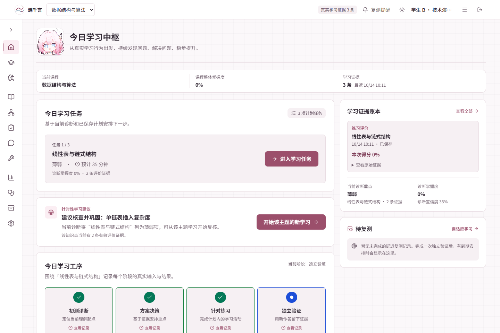
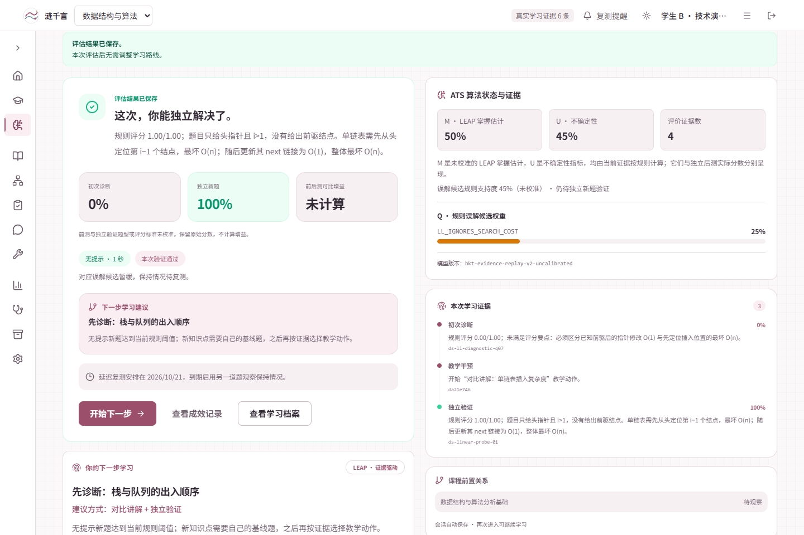
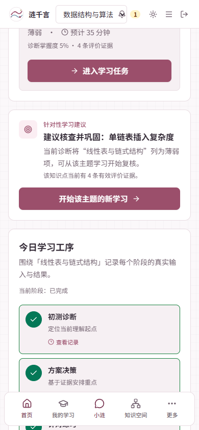
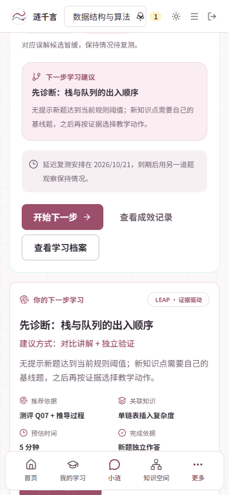

# Lian-LEAP 再次复审开发与冻结验收

日期：2026-10-14（Asia/Shanghai）。

**结论：`FREEZE_READY`，限定为当前本地功能候选。** 全量门禁和真实浏览器即时闭环已通过；真实七天保持数据为 `RETENTION_PENDING`，学生效果研究为 `RESEARCH_NOT_ESTABLISHED`，课程教师审核为 `HUMAN_PENDING`。本记录不表示已部署或已发布。

## 候选和范围

- 分支：`main`；HEAD：`a63da76880a631713baaaff158df1dec3dba28f4`。
- 候选：`a63da76-worktree-20261014-leap-freeze`，即上述 HEAD 加本轮未提交修改，不把 HEAD 当作已经包含本轮代码。
- 实际源码文件及 SHA-256 见 [candidate.json](candidate.json)。测试后再次核对文件哈希，防止将旧结果套用于变化后的文件。
- A/B/C 使用 `gpt-6-luna / xhigh` 并发实施和静态审阅，主集成负责接缝与 P3。P0–P2 未运行测试、构建或浏览器验收。
- 普通练习服务端评分和跨入口证据重放已存在，本轮保留其实现。后端唯一代码改动是旧内部 DTO 的说明文字。

本轮交付首页基于真实概览与诊断的单条推荐、主题深链置前、完成结果到档案入口、会话计数和未校准模型表述、架构及 README 说明。完成复测的推荐使用服务端 nextStep，不再套用旧 probe 结果。

## 最终门禁

| 命令/验收 | 最终结果 | 说明 |
| --- | --- | --- |
| `pnpm check` | PASS | TypeScript 与 ESLint 均通过 |
| `pnpm exec vitest run` | PASS | 126 个测试文件，407 项通过 |
| `pnpm exec node --test scripts/demo-video/demo-video-lib.test.mjs` | PASS | 12 项通过 |
| `pnpm build` | PASS | 最终生产构建完成 |
| `uv run pytest -q`（`apps/api`） | PASS | 348 项通过 |
| Chrome / Playwright 实际浏览器流程 | PASS | 30 项检查；1440×960、390×844；0 页面脚本异常 |

命令时间、退出码与批次见 [commands.json](commands.json)，浏览器逐项结果与脱敏请求路径见 [browser-acceptance.json](browser-acceptance.json)。Browser 插件不可用，使用已安装 Playwright 与本机 Chrome，没有新增项目依赖。

第一次最终门禁各套件均通过。随后实际 UI 暴露导出面板关闭缺陷，修复后重跑了受影响的前端完整 check/Vitest/build；后端和视频工具没有变化，保留同一 P3 的已通过结果，没有额外重跑。构建仍有 Pixi 大于 500 kB 的体积提示，后端仍有一条 Starlette/httpx 弃用提示，均未导致门禁失败。

## 真实产品流程

演示为操作者脚本作答，账号显示“学生 B · 技术演示续验”。账号、评分和 LearningEvidence 均由实际 UI/API 操作产生，没有预置掌握记录或改库制造成绩。临时服务只绑定 `127.0.0.1:8017`，使用 `.local/leap-freeze/runtime.db` 独立数据库，并提供本轮 `dist` 生产构建；现有数据库与服务未被用作演示写入目标。

| 观察点 | 本次事实 |
| --- | --- |
| 空账号 | 注册和选课后学习证据为空；首页给短诊断入口 |
| 普通练习 | 实际选择分别得到服务端 1 分和 0 分；公共请求字段为 learner/course/knowledge point/question/option，未提交 score/is_correct/difficulty |
| 恢复 | 刷新练习恢复已记录结果，没有第二次评价入账 |
| 首页推荐 | 真实诊断指向线性表薄弱项；卡片显示 2 条有效评价证据，目标为 `linked-list` |
| 深链 | `?topic=linked-list` 只预选，点击“开始诊断”后才创建会话 |
| 误解候选 | `ds-ll-diagnostic-q07` 得分 0，产生 `LL_IGNORES_SEARCH_COST` 候选及对应证据引用 |
| 策略 | D 组、无消融；实际执行 `contrastive_teaching`，未人为覆盖推荐 |
| 独立题 | 服务端分配 `ds-linear-probe-01`，与诊断/练习不同；讲解在独立阶段收起 |
| 独立结果 | 得分 1.0、independent=true、hintUsed=false；scoreComparable=false、observedGain=null |
| 规划 | assessmentStatus=saved；replanning.status=not_needed，原因 NO_MATERIAL_CHANGE；未伪称新计划已生成 |
| 档案 | 完成页按钮可进入档案；刷新恢复同一会话，档案呈现前测、教学、后测和待复测时间 |
| 成效和导出 | N 表示无提示后测会话数；可下载实际分组 CSV，表头不再称独立学生样本 |
| 手机 | 首页推荐按钮无遮挡且可点击；结果档案出口可用；页面无横向溢出；导出面板可正常关闭 |

事实字段见 [demo-case.json](demo-case.json)，公开文件用稳定引用代替账号、会话和证据 UUID。原始请求、认证状态与关联映射只保留在忽略的本地运行目录，不进入公开材料。

## 验收中发现并修复的真实缺陷

首轮在分组 CSV 下载完成后，点击导出面板“关闭”超时。复现时 Playwright 明确报告：固定顶栏的“退出登录”按钮截获点击。DOM 命中检查确认导出层虽然是 z-50，但仍嵌套在 z-10 的 main 内，低于 z-40 的顶栏。

修改 `OutcomeLabPage.tsx`，沿用项目档案导出组件已有的 `createPortal` 模式，将面板挂到 document.body。没有提高整站层级或强制点击绕过问题。最终生产构建中桌面和手机关闭均通过。首轮工具超时导致控制会话重置，因此使用第二个技术账号完整续验；两账号数据未合并为一个学习案例。

第一次的桌面截图（文件名 01–07）作为过程记录保留；最终案例截图使用 `r2-` 前缀。失败时含原始导出数据的截图只保留在 `.local/leap-freeze/export-close-interruption.png`。

浏览器预期 HTTP 情况为未登录时 `/api/auth/session` 返回 401，以及新账号尚无计划时 `/api/plans/current` 返回 404；除此之外，最终记录未出现失败业务请求或页面异常。

## 证据边界

- 真实复测计划：2026-10-21 10:12:02（北京时间）。没有调整时钟或预填复测成绩。
- 当前材料证明软件闭环可运行；操作者在约一秒内提交技术脚本答案，不能作为学生理解速度或教学效果数据。
- 前后测未完成量表校准，0→1 的两项原始成绩不能报告为“提升 100%”或因果教学增益。
- M/U/Q、分组及误解候选均沿用当前规则实现，不声称经过学生群体训练或校准。
- 未验证外部模型、云端语音、搜索服务、真实语音硬件或生产部署；这些不属于本轮冻结变更范围。
- 本次无 Git 提交、推送、合并、Release 或 ECS 部署。

## 最终截图

首页的真实主题建议：

独立结果与档案出口：

手机建议与结果出口：

