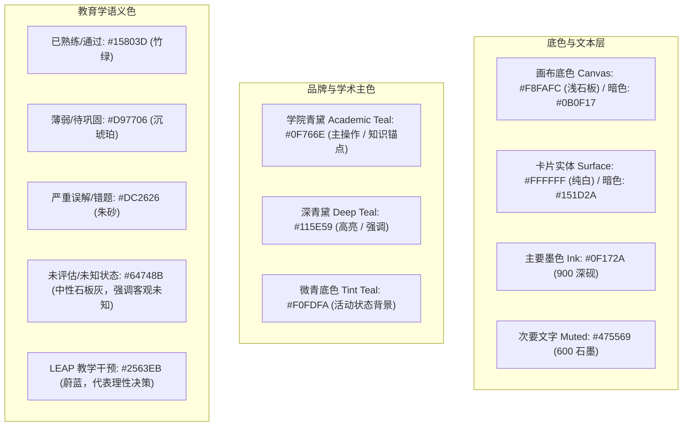
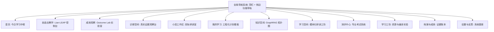
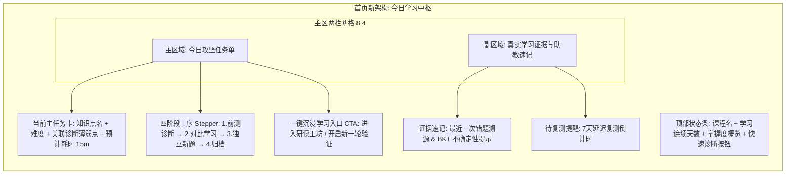
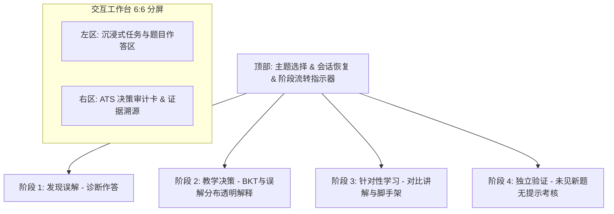
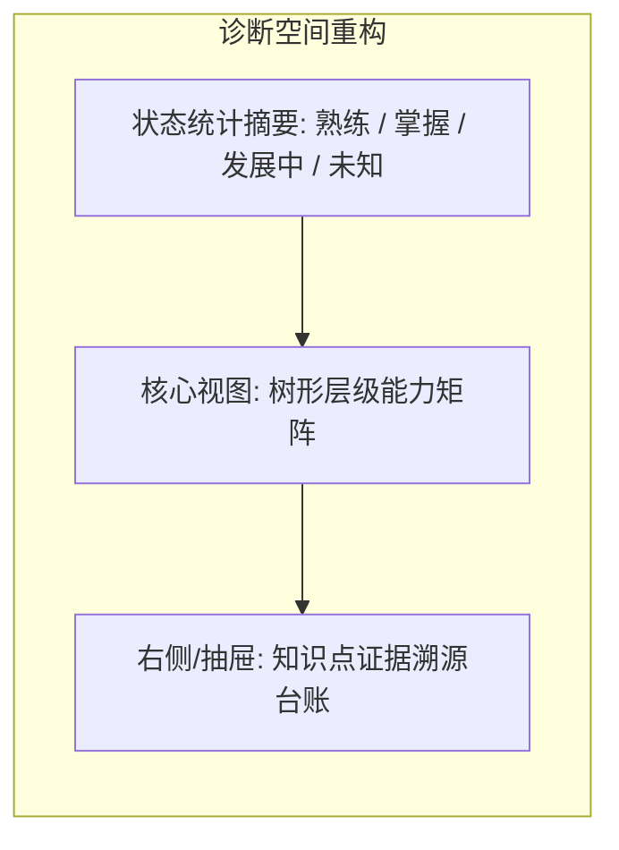
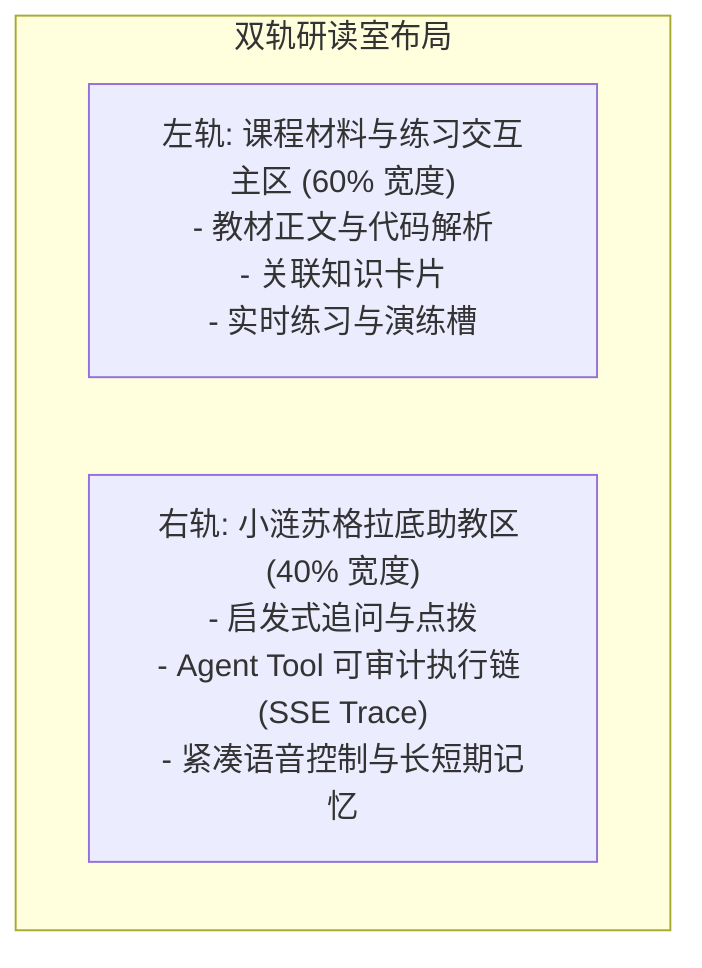
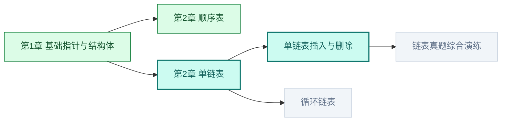

# 涟千言教育智能体全站 UI 重构方案
## —— 拒绝“AI 样板戏”，构建严谨、温润、可信的现代教育工作台

---

## 目录
- [一、 重构背景与现状诊断：破除“AI 样板戏”](#一-重构背景与现状诊断破除ai-样板戏)
- [二、 全局设计系统规范（The Grounded Design System）](#二-全局设计系统规范the-grounded-design-system)
  - [2.1 设计调性：从“二次元科幻”走向“人文书卷 × 现代工程工作台”](#21-设计调性从二次元科幻走向人文书卷--现代工程工作台)
  - [2.2 色彩体系：学术级克制配色与语义映射](#22-色彩体系学术级克制配色与语义映射)
  - [2.3 材质与表面：告别泛滥毛玻璃，回归物理实体层级](#23-材质与表面告别泛滥毛玻璃回归物理实体层级)
  - [2.4 字体、排版与认知工效学](#24-字体排版与认知工效学)
  - [2.5 学伴角色重塑：从“占位吉祥物”到“透明教学支架”](#25-学伴角色重塑从占位吉祥物到透明教学支架)
- [三、 逐页面细致重构优化方案（Page-by-Page Specifications）](#三-逐页面细致重构优化方案page-by-page-specifications)
  - [3.1 全局外壳与导航（AppShell / TopCompanionBar / LearningRail）](#31-全局外壳与导航appshell--topcompanionbar--learningrail)
  - [3.2 学习首页（Home - 今日聚焦与学习中枢）](#32-学习首页home---今日聚焦与学习中枢)
  - [3.3 自适应教学控制台（AdaptiveLearningPage - Lian-LEAP 实验闭环）](#33-自适应教学控制台adaptivelearningpage---lian-leap-实验闭环)
  - [3.4 成效观察实验室（OutcomeLabPage - 学术级对照与成效审计）](#34-成效观察实验室outcomelabpage---学术级对照与成效审计)
  - [3.5 学习诊断与观察空间（DiagnosisPage - 真实证据观察台）](#35-学习诊断与观察空间diagnosispage---真实证据观察台)
  - [3.6 小涟沉浸式工作区（XiaolianPage - 双轨交互研读室）](#36-小涟沉浸式工作区xiaolianpage---双轨交互研读室)
  - [3.7 我的学习（MyLearningPage - 工程化任务流与前置依赖）](#37-我的学习mylearningpage---工程化任务流与前置依赖)
  - [3.8 知识空间（KnowledgePage - GraphRAG 课程拓扑网络）](#38-知识空间knowledgepage---graphrag-课程拓扑网络)
  - [3.9 学习空间（LearningSpacePage - 模块化交互研读工坊）](#39-学习空间learningspacepage---模块化交互研读工坊)
  - [3.10 测评与考试中心（ExamPage - 专业考务与全息复盘）](#310-测评与考试中心exampage---专业考务与全息复盘)
  - [3.11 创作工坊与扩展工具（ResourcesPage - 工具箱与来源边界）](#311-创作工坊与扩展工具resourcespage---工具箱与来源边界)
  - [3.12 学习档案（ArchivePage - 终身证据账本与成长溯源）](#312-学习档案archivepage---终身证据账本与成长溯源)
  - [3.13 反思空间（ReflectionPage）与 系统设置（SettingsPage）](#313-反思空间reflectionpage与-系统设置settingspage)
- [四、 核心组件替换清单与技术落地路径](#四-核心组件替换清单与技术落地路径)

---

## 一、 重构背景与现状诊断：破除“AI 样板戏”

在 iCAN 比赛与实际高等教育教学场景中，许多所谓“AI 教育产品”往往陷入浮夸、形式主义的**“AI 样板戏（AI Cliche）”**。经过对当前项目（如 `src/components/design/NebulaBackground.tsx`、`GlassPanel.tsx`、`HeroBanner.tsx`、`KnowledgeStarMap.tsx` 等）的全面代码走查，当前系统存在以下四大明显痛点：

### 1. 痛点诊断：过度 AI 化的四大表象

| 维度 | 当前实现痛点（AI 样板戏） | 带来的负面影响 |
| :--- | :--- | :--- |
| **视觉基调** | 满屏霓虹紫粉渐变（`#8b7cf6`、`#ff9fcb`）、三层放射状模糊光晕、星空漂浮发光粒子（`PARTICLES`、`em-orbit-pulse`） | 廉价科幻感与二次元玩具感严重，严重削弱了计算机学科（如数据结构、算法、操作系统）应有的学术严谨性，导致长时间学习视觉疲劳。 |
| **界面材质** | 滥用强模糊毛玻璃（`backdrop-blur-xl bg-white/55`）、过大圆角（`rounded-[28px]`~`32px`）、极细高亮边框 | 文字与背景对比度严重不足，信息层次浑浊；强烈的透明高光分散学生注意力，不符合 WCAG 2.1 AA 无障碍可读性标准。 |
| **交互模型** | “Chat 框解决一切”（单调的对话气泡流）、“小涟”大头贴与 Live2D 模型在多处占据黄金视觉中心（`w-52`~`23rem`） | 沦为“吉祥物展览”与“问答黑盒”。学生缺乏真正的“工作台”去阅读教材、调试代码、对比推导、沉浸做题与查看证据。 |
| **教学解释** | 滥用 `Sparkles`（✨ 星星图标）及“超脑正在运算”、“AI 智能预测”等虚浮词汇，BKT 掌握度与不确定性指标缺乏直观业务实体支撑 | 评委与师生对 AI 输出缺乏信任感，无法直观查验算法决策的证据依据（Evidence-based pedagogy）。 |

### 2. 重构核心战略：走向“循证教育工作台”
本重构方案将“涟千言”从**“轻浮的 AI 星空伴读玩具”**彻底重塑为**“严谨、温润、可信赖的现代高等教育研读工作台（Pedagogical Workbench）”**。

```mermaid
graph LR
  subgraph 旧方案：浮夸AI秀
    A1[星空粒子与紫色光晕] --> A2[全屏毛玻璃与大头贴]
    A2 --> A3[黑盒Chat框与魔法✨]
  end

  subgraph 新方案：现代循证研读台
    B1[温润纸张底色与青黛墨黑] --> B2[高清晰实体卡片与严谨网格]
    B2 --> B3[双轨工作台：沉浸研读 + 启发支架]
    B3 --> B4[透明证据台账：BKT公式/推导链/未见题验证]
  end
```

---

## 二、 全局设计系统规范（The Grounded Design System）

### 2.1 设计调性：从“二次元科幻”走向“人文书卷 × 现代工程工作台”
- **设计隐喻**：古今结合的**“学术书斋 × 现代代码工坊”**。既有阅读经典专著时的温润、沉静与专注，又有现代 IDE/工坊的高效、严谨与结构分明。
- **环境静音（Calm Tech 原则）**：界面中除了用户主动交互（如提交代码、点击试题、展开证据）带来的反馈外，**杜绝任何无意义的自转动画、漂浮粒子和呼吸跑马灯**。把屏幕的最高对比度和视觉重心 100% 留给学习内容本身。

### 2.2 色彩体系：学术级克制配色与语义映射
彻底废除刺眼的霓虹高饱和紫（`#8b7cf6`）与粉红（`#ff9fcb`），采用经过色彩工效学验证的“青黛-墨韵”学术配色。



#### CSS Token 变量替换定义
```css
:root {
  /* 画布与表面：实体、稳定、高对比 */
  --em-canvas: #f8fafc;            /* 浅石板冷白，抗眩光 */
  --em-surface: #ffffff;           /* 纯白实体表面 */
  --em-surface-subtle: #f1f5f9;    /* 次级功能背景（代码块、表头） */
  --em-border: #e2e8f0;            /* 1px 精细分界线 */
  --em-border-strong: #cbd5e1;     /* 交互边框线 */

  /* 墨色排版：黑体层级分明 */
  --em-ink: #0f172a;               /* 浓墨：用于大标题与关键正文 (Slate 900) */
  --em-muted-ink: #475569;         /* 石墨：用于说明、辅助文本 (Slate 600) */
  --em-subtle-ink: #94a3b8;        /* 淡墨：用于占位、时间戳 (Slate 400) */

  /* 核心主调：青黛 (Academic Teal) */
  --em-primary: #0f766e;           /* 主青色 (Teal 700) */
  --em-primary-hover: #115e59;     /* 悬浮深青 (Teal 800) */
  --em-primary-subtle: #ccfbf1;    /* 徽标底色 (Teal 100) */

  /* 循证教育状态色：拒绝含混 */
  --em-status-mastered: #15803d;   /* 掌握 (Emerald 700) */
  --em-status-weak: #d97706;       /* 薄弱 (Amber 600) */
  --em-status-misconception: #dc2626; /* 误解 (Red 600) */
  --em-status-unknown: #64748b;    /* 未评估：客观冷静 (Slate 500) */
  --em-status-decision: #1d4ed8;   /* LEAP 干预 (Blue 700) */

  /* 阴影：细腻微弥散，摒弃浓重炫光 */
  --em-shadow-sm: 0 1px 2px 0 rgba(15, 23, 42, 0.05);
  --em-shadow-md: 0 4px 6px -1px rgba(15, 23, 42, 0.07), 0 2px 4px -2px rgba(15, 23, 42, 0.05);
  --em-shadow-lg: 0 10px 15px -3px rgba(15, 23, 42, 0.08), 0 4px 6px -4px rgba(15, 23, 42, 0.04);
}
```

### 2.3 材质与表面：告别泛滥毛玻璃，回归物理实体层级
- **废弃规则**：
  - 全局彻底下线 `NebulaBackground.tsx` 中的紫/粉色模糊球和发光粒子。
  - 废弃 `em-glass` 的 `backdrop-blur(20px)` 与半透明 `bg-white/55`。
- **全新层级规范**：
  - **Level 0 (底板)**：`#f8fafc` 纯净画布，可附带超低透明度（2%）的 16px 精密工程网格底纹（仅用于传达学术理性，不喧宾夺主）。
  - **Level 1 (主卡片容器)**：纯白 `#ffffff`，带 `border: 1px solid #e2e8f0`，无眩光，轻量微阴影 `--em-shadow-sm`。
  - **Level 2 (弹窗与浮层)**：纯白带 `--em-shadow-lg` 与精细实体边框，非模态蒙层使用沉静的 `rgba(15, 23, 42, 0.4)`。
- **圆角收敛**：
  - 按钮/输入框：从 `rounded-[18px]` 收敛至规范的 `rounded-lg (8px)`。
  - 卡片面板：从臃肿的 `rounded-[28px]`~`rounded-[32px]` 收敛为利落专业的 `rounded-xl (12px)` 或 `rounded-2xl (16px)`。

### 2.4 字体、排版与认知工效学
- **字体族**：中文字体首选 `"PingFang SC"`, `"Noto Sans SC"`, `"Microsoft YaHei"`；英文字体使用 `Inter`, `system-ui`；代码与算法推理统一使用等宽字体 `JetBrains Mono`, `Consolas`, `monospace`。
- **排版节奏（8pt 栅格律动）**：
  - 正文字号：14px (小桌面/密集表格) 与 15px/16px (研读区)，行高严格锁定在 `1.65` 至 `1.75`，保障连续 40 分钟阅读不眼花。
  - 标题层级严密：Page Title (`text-2xl font-bold`) -> Section Title (`text-lg font-semibold`) -> Card Title (`text-sm font-semibold`)，严禁出现空洞占位的巨型口号字。

### 2.5 学伴角色重塑：从“占位吉祥物”到“透明教学支架”
在“去 AI 化”后，小涟不再是一个漂浮在屏幕中央挤占空间的 3D/Live2D 装饰，而是转型为**“可审计的专业助教工作台（Auditable Pedagogical Scaffolding）”**：
1. **尺寸与布局**：在非专门对话页面，小涟退居为紧凑的状态指示微标（28px 头像 + 单行透明状态：“正在审计 BKT 掌握度” / “已准备 2 道针对性练习题”）。
2. **拒绝黑盒口吻**：把“小涟觉得你很棒”、“小涟为你推演了未来”等空泛拟人话术，改为严谨的教育学术语：“基于今日 14:20 二叉搜索树前测（得分 0/2），检测到边界条件误解 $Q_2$，建议优先进行对比讲解”。
3. **可审计执行链（Agent Trace）**：公开工具调用、知识检索来源（具体到《数据结构》教材第 4 章第 2 节），赋予学生与教师 100% 的核实权。

---

## 三、 逐页面细致重构优化方案（Page-by-Page Specifications）



---

### 3.1 全局外壳与导航（AppShell / TopCompanionBar / LearningRail）

#### 痛点剖析
- 当前 `LearningRail` 在左侧浮动，使用毛玻璃长胶囊，图标配有多色渐变横条与小涟浮动气泡，在宽屏下占位过大且分组界限模糊（`start`, `explore`, `record` 的含义缺乏教学逻辑）。
- 顶部 `TopCompanionBar` 把“和小涟聊聊”做成巨大彩色按钮，却把当前课程切换、今日学习时长等关键教学上下文隐匿了。

#### 重构方案
1. **外壳布局（Modern Studio Layout）**：
   - 采用标准 3 级结构：固定高度 56px 的**全局工作台顶栏** + 紧凑型 64px 宽（可一键展开至 200px）的**左侧学术导轨** + 主内容区。
2. **顶栏功能增强 (`TopCompanionBar`)**：
   - **左侧**：简洁的品牌标识（“涟千言” + 紧凑徽标，无发光渐变）+ **当前学习课程快速选择器**（如：`《数据结构与算法》 · 2026秋`）。
   - **中间**：**学习状态心跳条（Evidence Status Chip）**，显示客观实时数据：“已记录真实证据 18 条 ｜ 今日掌握度变动 +12%”。
   - **右侧**：当前账号名称、通知中心、暗/亮模式切换开关，去除浮夸彩色按钮。
3. **侧栏结构重组 (`LearningRail`)**：
   将 11 个入口按照认知学习循环（Experiential Learning Cycle）重新归类：
   - **阶段一：日常闭环**：首页（今日聚焦）、我的学习（计划与进度）、自适应学习（LEAP 靶向干预）。
   - **阶段二：探究与实战**：学习空间（教材与研读）、知识图谱（概念网络）、测评中心（真题考核）、研读助教（小涟对话）。
   - **阶段三：成效与沉淀**：成效实验室（对照实验）、学习诊断（证据矩阵）、学习档案（成长账本）、系统设置。
   - 交互上：选中态采用沉稳的 `bg-teal-50 text-teal-800 border-l-2 border-teal-600`，彻底替代原先的紫红色荧光跑马灯。

---

### 3.2 学习首页（Home - 今日聚焦与学习中枢）

#### 痛点剖析
- 当前页面由 `HeroBanner`、`TodaysJourney`、`XiaolianDailyInsight` 拼合，上方是巨大的小涟立绘展示与“证据星河轨道”旋转动效，下面是重复的“TODAY'S JOURNEY”英文口号。新注册空白账号没有数据时，显示大量模拟占位符或空白，信息获取效率低下。

#### 重构方案：从“宣传大屏”转型为“今日沉浸学习看板”



#### 细化优化点
1. **移除 `HeroBanner` 浮夸元素**：
   - 移除背景紫色星空球、`em-orbit-pulse` 动效与占据半屏的立绘。
   - 替换为**高信息密度的紧凑型行动台（Action Deck）**：明确展示“今日建议突破：单链表插入与边界条件（BKT 掌握度当前 32%）”。
2. **改造 `TodaysJourney` 为标准工序步进器（Pedagogical Stepper）**：
   - 不再使用抽象的“星轨轨道”，改为真实教学四步流程卡：
     1. `初测诊断`（已完成，定位误解 $Q_1$）
     2. `方案决策`（已匹配对比教学策略）
     3. `针对练习`（当前进行中，完成 1/2）
     4. `独立验证`（待进入，需作答 1 道独立新题）
   - 每一步清晰标注状态图标（已完成绿色 Check、进行中蓝色圆点、待开启灰色实心锁），点击卡片可查看对应阶段的输入输出记录。
3. **真实空白态（Honest Zero-State）**：
   - 若当前为全新账号，页面显示“欢迎进入学习空间。系统尚未记录你的作答数据，建议从 **5 分钟快速水平摸底诊断** 开始”，提供清晰的首发引导，杜绝伪造假数据。

---

### 3.3 自适应教学控制台（AdaptiveLearningPage - Lian-LEAP 实验闭环）

#### 痛点剖析
- 该页面是本项目核心学术亮点（Lian-LEAP 教学实验闭环），但目前各个卡片边界不清，AI 决策与传统内容堆砌，缺少自适应教学（Adaptive Tutoring System, ATS）的控制台质感。算法指标（$M, U, Q$）与实际题目的联动不够直观。

#### 重构方案：科研级透明自适应教学工作台



#### 细化优化点
1. **两栏分屏自适应布局（Split ATS Workbench）**：
   - **左栏（题目与教学交互）**：题目描述排版清晰，支持 LaTeX 公式排版与等宽代码块高亮，代码缩进严密；选项与主观答题框具备清晰的焦点边框。
   - **右栏（算法决策与认知诊断仪表盘）**：
     - **BKT 掌握度 $M$ 仪表**：显示数值百分比与置信区间，直观解释其更新前后的变化（如：$0.32 \to 0.78$）。
     - **不确定性指标 $U$**：清晰告知学生“当前作答样本量为 3 题，不确定性已降至 0.15（充分可信）”。
     - **误解候选分布 $Q$**：以水平条形堆叠图清晰展示候选误解（例如：“指针赋值顺序颠倒：75% 概率；内存泄漏：15%”）。
2. **去 AI 化的干预呈现（Pedagogical Interventions）**：
   - 将原先带有 ✨ 的魔法按钮替换为具备教学法依据的**六项结构化动作**：
     - `对比讲解`（以“正确 vs 典型错误实现”双栏 diff 方式呈现）
     - `前置知识补强`（展开单链表结构定义）
     - `分步脚手架练习`（带提示练习，并在顶部明确提示：“本阶段含提示作答，成绩不计入独立验证掌握度”）
     - `独立新题验证`（强制进入无提示考场模式，杜绝作弊与自欺）。

---

### 3.4 成效观察实验室（OutcomeLabPage - 学术级对照与成效审计）

#### 痛点剖析
- 当前页面承载了真实前后作答成绩、教学过程、策略对照与延迟复测。目前使用的是普通后台风格，缺少严谨的学术科研报告感，未能充分展现 A/B/C/D 对照实验与消融研究的科学严谨性。

#### 重构方案：教育科研实验报告看板（Educational Research Lab）

```mermaid
flowchart TD
    subgraph 实验看板架构
        Overview[1. 实验概览卡: 样本数 + 完成会话数 + 均值增益 + 延迟保持率]
        Groups[2. 四组策略机制对照矩阵 (A固定基线 / B课程固定 / C证据动态 / D完整LEAP)]
        Analytics[3. 前后测对比图: Pre-Test vs Post-Test vs 7-Day Retest]
        Export[4. 数据审计与导出: 符合公开规范的 JSON/CSV 全量导出]
    end
```

#### 细化优化点
1. **学术级统计图表与指标卡**：
   - 顶部指标卡：使用中性灰石板底色，指标排版规范（样本量 $N$、标准差 $SD$、归一化学习增益 $g = \frac{Post - Pre}{1 - Pre}$）。
   - 彻底废除花哨的纯色圆角大色块，采用清晰的柱线组合对比图，明确标注前测（Pre-test）、即时后测（Post-test）、7天延迟复测（Delayed Retest）。
2. **四组机制透明对照卡片（Mechanism Matrix）**：
   - 采用标准网格对比表（Table Grid），列出 A、B、C、D 组在“误解诊断”、“动态动作排序”、“无提示验证”维度的开启状态。
   - 针对未完成延迟复测的记录，诚实展示“待采集（7天后解锁）”，杜绝生成任何假预测折线。
3. **可审计数据导出抽屉**：
   - 提供格式规范的 JSON 结构化预览抽屉，展示时间戳、题目哈希、用户作答和掌握度更新微积分记录，直接满足 iCAN 比赛专家评委的现场真实性查验。

---

### 3.5 学习诊断与观察空间（DiagnosisPage - 真实证据观察台）

#### 痛点剖析
- 当前使用的是 `KnowledgeStarMap`（知识星图），节点像星系一样悬浮，节点之间是弯曲的星空连线。这种视觉效果不仅在缩放时极易产生眩晕感，而且无法快速定位“未掌握”与“未评估”的知识点，无法作为科学严肃的学习诊断工具使用。

#### 重构方案：知识能力状态矩阵与证据溯源账本



#### 细化优化点
1. **废弃宇宙星图，重构为结构化树形能力矩阵（Curriculum Mastery Matrix）**：
   - 按照课程章节树状排列（例如：`第1章 线性表` $\to$ `顺序表`、`单链表`、`双向链表`、`循环链表`）。
   - 每个节点使用统一的**矩形状态徽章卡**：
     - 标题与知识点 ID
     - 状态标签（绿色“已掌握”、橙色“需巩固”、灰色“未评估”）
     - 掌握度水平刻度条（微型单色进度条，附百分比）
2. **严谨区分“未知”与“薄弱”**：
   - 强化界面提示文案：“系统对无作答证据的知识点标注为【未知】，未知不等于薄弱，系统绝不凭空推断 0% 掌握度”。
3. **右侧证据溯源面板（Evidence Drawer）**：
   - 点击任一知识点，右侧滑出该知识点的**全生命周期证据流水**：
     - 作答时间（如 `2026-10-12 19:30`）
     - 题目来源（`期中自测` 或 `LEAP独立验证`）
     - 作答结果与判定原因（“正确，解答时长 42s，无提示完成”）
     - 为什么给出该评分的算法解释与下一步建议。

---

### 3.6 小涟沉浸式工作区（XiaolianPage - 双轨交互研读室）

#### 痛点剖析
- 当前是一个传统的模仿 ChatGPT 的全屏对话页面，伴随一个右下角悬浮或顶部的小涟立绘。学生在对话框里既要看长篇概念讲解，又要看代码，非常容易迷失在长滚动的历史消息中；而且将所有学习功能硬塞进对话框，逼迫学生自己去写 prompt，违背了现代认知教育工效学。

#### 重构方案：双轨研读工作台（Dual-Pane Study Studio）



#### 细化优化点
1. **从“单一聊天框”改为“双轨协作分屏”**：
   - **左轨（学习主阵地）**：展示当前正在讨论的课程主题核心正文、伪代码模拟、图文结构拆解；学生可以在此划词做笔记、尝试单步执行。
   - **右轨（学伴支架区）**：小涟以苏格拉底启发法提出追问（例如：“你刚才写到 `p->next = q;`，此时如果原链表后续节点没有保存，会发生什么后果？”）。
2. **Agent Tool Trace 审计折叠栏**：
   - 流式响应中的工具调用（如 `GraphRAG 检索`、`BKT 状态查询`、`AnySearch 校验`）使用利落的代码展开栏，展示清晰的阶段名与检索耗时，不使用闪烁的玄学图标。
3. **紧凑多模态语音与记忆面板**：
   - 语音输入/MiniMax 语音输出控制收敛至底部输入框右侧的极简控件，包含波形状态指示；长期记忆抽屉支持学生自由查看与撤销（“小涟已记住你倾向于使用 C++ 语言作答”）。

---

### 3.7 我的学习（MyLearningPage - 工程化任务流与前置依赖）

#### 痛点剖析
- 当前使用的是 `QuestCard`（游戏化任务卡片）配合雷达图。将严肃的计算机工程学习包装成二次元 RPG 任务（“探索秘境”、“讨伐知识点”），违背了大学专业课程的学习心智；且雷达图在多于 6 个知识点时重叠严重，极难阅读。

#### 重构方案：工程化学习工单流与依赖图谱

```mermaid
flowchart TD
    subgraph 我的学习新布局
        TopBar[学习目标与周期进度条: 当前冲刺阶段 · 2/5 任务完成]
        subgraph 主区看板
            Task1[已完成工单: 单链表定义与基本结构]
            Task2[进行中工单: 单链表尾插与边界条件 ★核心攻坚]
            Task3[待开始工单: 双向循环链表设计 (锁定: 需完成 Task2)]
        end
        Task2 --> Modal[一键启动工作台: 显示前置证据、目标要点、耗时]
    end
```

#### 细化优化点
1. **替换游戏化 Quest 卡片为清晰的“学习工单卡片”**：
   - 移除“任务星级”、“金币/经验”等虚浮游戏概念。
   - 替换为：知识模块、先决条件依赖指示（Prerequisite Badge）、预计攻坚耗时、当前掌握度对比（前测 vs 目标）。
2. **废除容易重叠的多边形雷达图**：
   - 替换为**紧凑型条形能力对照表（Horizontal Mastery Breakdown）**，每一行清晰展示：知识点名、证据数、掌握度数值、状态标签，支持按薄弱程度直接排序。

---

### 3.8 知识空间（KnowledgePage - GraphRAG 课程拓扑网络）

#### 痛点剖析
- 当前使用的是 `KnowledgeGalaxy`，仿三维宇宙星系，节点漂浮拖拽。在实际使用中，学生往往找不到当前学到哪、知识点之间的严谨前后置关系被华丽的粒子和光晕掩盖，无法体现 GraphRAG 知识图谱的技术价值。

#### 重构方案：工程级课程概念有向无环拓扑图（Concept DAG Map）



#### 细化优化点
1. **清晰的 DAG 拓扑分层（Topological Hierarchy）**：
   - 采用自左向右的标准概念依赖流向，线条使用精细实线与方向箭头（Prerequisite Arrow），清楚表明“学 C 必须先学 A”。
2. **节点状态一目了然**：
   - 绿色填充：已牢固掌握；
   - 青黛实线加粗：当前攻坚节点；
   - 灰色虚线：前置未解锁；
   - 琥珀色微标：检测到高频易错误解。
3. **左侧大纲树 + 右侧概念速查抽屉**：
   - 左侧保留教材目录树，点击即可在图谱中高亮居中；点击右侧抽屉，查看该知识点的 GraphRAG 关联三元组实体与权威教材定义。

---

### 3.9 学习空间（LearningSpacePage - 模块化交互研读工坊）

#### 痛点剖析
- 当前页面功能非常全面（包含教材、辅导、练习、反思、制品、上下文等），但左右两边抽屉过多（`guide`, `artifacts`, `history`, `context`, `sources`），界面被分割得非常零碎，缺乏一个主线明确的沉浸式操作主场。

#### 重构方案：沉浸式研读工作台（Integrated Study Deck）
1. **主次清晰的三段式横向布局**：
   - **左栏（25% 紧凑大纲与导航）**：当前模块小节列表与阶段检查点（概念学习 $\to$ 深度推演 $\to$ 针对练习 $\to$ 总结反思）。
   - **中栏（50% 核心阅读与代码区）**：教材核心要点、交互式动图或代码演练槽，支持代码高亮与行号对照。
   - **右栏（25% 学伴交互与证据侧栏）**：平时以折叠徽标收起，需要时展开“小涟即时点拨”与“练习评估面板”，不再遮挡中栏的阅读视线。
2. **操作反馈收敛**：
   - 练习完成后，即时给出要点匹配率与详细错因，不弹窗打断，直接在中栏下方呈现评估报告与一键进入下一任务的通道。

---

### 3.10 测评与考试中心（ExamPage - 专业考务与全息复盘）

#### 痛点剖析
- 标签页上方使用了过多彩色渐变背景卡（`bg-sky-50`, `bg-fuchsia-50`, `bg-amber-50`），色彩过多引起视觉混乱；作答时缺乏真实考试的防干扰沉浸感。

#### 重构方案：标准化自适应考务与复盘工作台
1. **去除花哨彩色 Tabs**：统一为精致的灰底胶囊切换栏（当前测评、作答历史、题库浏览、自主组卷）。
2. **独立考场沉浸模式（Zen Exam Mode）**：
   - 点击“开始测评”后，自动隐藏全局侧栏与顶栏干扰项。
   - 右侧固定**答题卡网格**（标明已作答、未作答、标记待核验题号），顶部保留清晰倒计时与自动保存状态，底部设有双重确认的“交卷”安全闸。
3. **全息成绩复盘（Audit Review）**：
   - 提交后立刻进入“结构化复盘页”：展示得分率、按知识点的失分归因，以及一键将错题无缝打包进 `Lian-LEAP 自适应学习` 进行针对性补强的快速通道。

---

### 3.11 创作工坊与扩展工具（ResourcesPage - 工具箱与来源边界）

#### 痛点剖析
- 资源生成、AnySearch 联网检索和受限编译器散落三处，AI 生成图片与文本存在“魔法感”，联网检索缺乏对外部来源可信度的明确标注。

#### 重构方案：工程生产力工具箱（Developer & Scholar Toolkit）
1. **工具箱统一为“输入参数 - 处理过程 - 产物预览”三列流水线**。
2. **AnySearch 联网检索的“权威度与来源可信度”标牌**：
   - 清晰标注外部网页来源（如：`维基百科`、`CSDN`、`GeeksforGeeks`）、爬取时间戳与可信度等级，明确保留课程内部 GraphRAG 与外部互联网知识的边界。
3. **编译模拟器增强**：
   - 明确标注为“受约束的语义模拟执行器”，提供内存栈帧与指针走向的可视化步进，不宣称伪造的真实服务器执行。

---

### 3.12 学习档案（ArchivePage - 终身证据账本与成长溯源）

#### 痛点剖析
- 目前采用二次元“故事时间线（Storybook）”，将严肃的学习记录包装成童话故事。这既不符合高等教育严谨记录的要求，也无法用于奖学金申报或比赛答辩。

#### 重构方案：终身学习数字证据账本（Evidence-Based Learning Dossier）
1. **成长总览矩阵**：
   - 累计作答题目数、真实掌握度均值曲线、已消除高频误解列表、LEAP 实验完成周期。
2. **按时间倒序的可审计证据账本（Evidence Ledger）**：
   - 类似财务账本的表格化流式记录：
     `[时间] 2026-10-13 15:30 ｜ [事件] 二叉搜索树独立验证 ｜ [结果] 正确 (95分) ｜ [影响] BKT掌握度从 41% 更新至 82% ｜ [关联题目ID] #q-bst-insert-04`。
3. **导出正式答辩报告（Export Dossier）**：
   - 提供一键导出排版规范、黑白分明的标准 PDF 学习成效报告，附有带数字签名的实验数据摘要，供 iCAN 比赛评审专家审阅。

---

### 3.13 反思空间（ReflectionPage）与 系统设置（SettingsPage）

1. **反思空间（ReflectionPage）**：
   - 移除花哨的感悟大卡片，采用经典的**元认知三问脚手架（Metacognitive Scaffolding）**：
     - ① “本次练习中，我最初的思维盲区在哪里？”
     - ② “关键转折点（如指针转移顺序）的核心逻辑是什么？”
     - ③ “未来遇到同类变形题时，我的第一排查步骤是什么？”
   - 反思输入后作为元认知证据存入个人画像数据库。
2. **系统设置（SettingsPage）**：
   - 采用标准企业级设置分栏：外观主题、AI 模型连接、MiniMax 语音服务、远程 MCP 令牌管理。
   - 敏感信息（API Key）默认脱敏并带掩码复制按钮，实时探针显示服务连通延迟（如：`MiniMax 服务：连通正常 (112ms)`），界面简洁高效。

---

## 四、 核心组件替换清单与技术落地路径

### 1. 核心设计组件重构与替换映射表

| 原组件文件路径 | 存在的主要问题 | 重构替代方案 / 修改方向 |
| :--- | :--- | :--- |
| `src/components/design/NebulaBackground.tsx` | 浮夸三色模糊光晕、白色发光粒子、`em-nebula` | 重构为 `WorkbenchBackground.tsx`：移除粒子与光斑，采用极简冷白画布与 2% 不透明度微工程网格底纹。 |
| `src/components/design/GlassPanel.tsx` | `em-glass` 强毛玻璃模糊、低对比度半透明 | 重构为 `SolidPanel.tsx`：纯白实体卡片，1px `border-slate-200`，收敛圆角至 12px/16px，微弥散物理阴影。 |
| `src/components/layout/LearningRail.tsx` | 纵向发光条、多色渐变横线、气泡跑马灯 | 去除发光条与浮夸悬浮动画；重塑为 3 阶段认知流程导航，选中态改为沉稳的深青黛实体高亮。 |
| `src/components/layout/TopCompanionBar.tsx` | 缺少课程选择器与证据心跳，彩色按钮冗余 | 增加当前课程快速下拉框，增加“真实证据计数条”，优化账户与暗黑模式切换布局。 |
| `src/components/home/HeroBanner.tsx` | 巨型立绘占位、紫色渐变大横幅、空洞口号 | 重构为“今日学习行动中心”，聚焦今日需攻坚的薄弱点、BKT 现状与沉浸式进入按钮。 |
| `src/components/home/TodaysJourney.tsx` | 抽象星空轨道，多重边框嵌套 | 重构为标准四步循证工序步进器（诊断 $\to$ 决策 $\to$ 练习 $\to$ 验证）。 |
| `src/components/diagnosis/KnowledgeStarMap.tsx` | 3D 宇宙悬浮球、混乱曲线连线 | 重构为树状层级能力矩阵卡片，支持章节折叠与精准状态筛选（掌握/薄弱/未知）。 |
| `src/components/xiaolian/XiaolianCharacter.tsx` | 尺寸过大（占据 23rem）、无意义微动 | 在常规业务页面缩小至 28px/36px 伴学状态徽章，仅保留双轨研读室中的紧凑形象。 |
| `src/design/theme.css` | 充斥霓虹紫粉变量与暗黑强制背景重载 | 全面重写 CSS Variables，确立青黛（Teal）、墨黑（Slate）与真实教学状态色体系。 |

### 2. 渐进式交付路线图（4 步安全落地法）

```mermaid
flowchart TD
    Step1[阶段一: 基础设计代币与全局外壳净化\n- 重构 theme.css 与 index.css (建立青黛学术色系)\n- 替换 NebulaBackground 为纯净 WorkbenchBackground\n- 规范化 SolidPanel 实体卡片\n- 升级 AppShell / TopCompanionBar / LearningRail]
    Step2[阶段二: 核心闭环页面去 AI 化改造\n- 首页 Home: 今日攻坚看板与四步 Stepper\n- 自适应教学 AdaptiveLearningPage: ATS 双栏控制台\n- 成效实验室 OutcomeLabPage: 学术级对照看板]
    Step3[阶段三: 知识空间与研读工作台深度重构\n- 诊断页 DiagnosisPage: 树状矩阵与证据抽屉\n- 小涟研读室 XiaolianPage: 双轨分屏协作模式\n- 知识拓扑 KnowledgePage: DAG 概念网络]
    Step4[阶段四: 考务、档案与全站质量门禁\n- 测评页 ExamPage: 沉浸考场与复盘\n- 档案页 ArchivePage: 结构化证据账本与导出\n- 执行严格的 pnpm check 与全功能走查]

    Step1 --> Step2 --> Step3 --> Step4
```

### 3. 工程契约保障
- 所有修改均遵循现存的 `AGENTS.md` 规范：
  - 严格使用 `pnpm` 包管理器；
  - 保持 React 纯函数组件与 Hooks 规范；
  - 修改后保证 `pnpm check`（`tsc --noEmit` + `eslint`）100% 绿灯无报错通过；
  - 不破坏任何已有的 API 数据流与后端会话认证安全机制。
