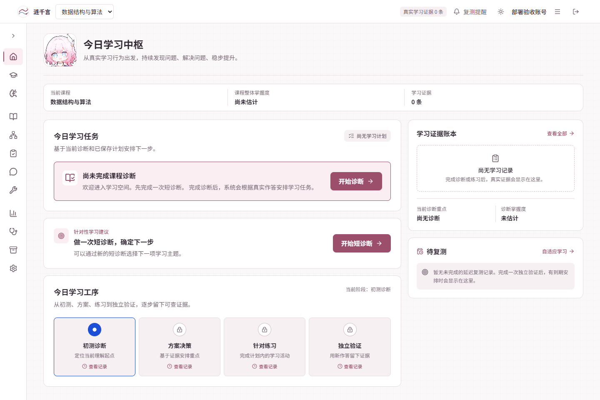

# 涟千言 LEAP 冻结候选：远端推送与 ECS 部署记录

日期：2026-10-14（Asia/Shanghai）。状态：**部署和公网必要验收通过**。

公网入口：[涟千言](https://8.156.67.132/lianqianyan/)。

## 应用提交与实际发布

| 项目 | 实际值 |
| --- | --- |
| 应用提交 | `a66354665d56e96b2ef00f6648ecdc7946e4e740` |
| 应用分支 | `main`，已推送到 `origin/main` |
| 发布标识 | `20261014-a66354665d56` |
| 发布时间 | 2026-10-14 12:49:10（北京时间） |
| current | `/opt/apps/lianqianyan/releases/20261014-a66354665d56` |
| previous | `20261007-7129efd87579` |
| API 镜像 | `lianqianyan-api:1.4.0-a66354665d56` |
| Web 镜像 | `lianqianyan-web:1.4.0-a66354665d56` |
| 两个镜像 revision | 均为上述完整应用提交 |
| 发布上下文 SHA-256 | `5cf3aafa0b3a8c90c615fa69ddb24e063513d972a80f7afbec72d583cd19f47c` |
| 离线应用镜像归档 SHA-256 | `bc405f3d3ee108b57c41f373cdd4e0e2c991769a2ac1b609a8ff003664b719af` |

此文档及其证据由后续文档提交保存；文档提交不会重新构建应用。服务器实际应用版本以上表的应用提交和发布回执为准。

应用提交的 [GitHub CI](https://github.com/ChaoDaiShi/lianqianyan/actions/runs/38512525286) 已完成，Frontend 与 Backend 两个作业均为 success。推送前核对了已验收的 15 个源码文件哈希，未发现漂移。本次没有重复跑本地完整测试；按服务器子路径配置重新构建了前端发布工件。

## 构建与升级过程

前端沿用 `deploy/server/build-release.ps1`，使用 `VITE_BASE_PATH=/lianqianyan/` 和 `VITE_EDUCATION_API_URL=/lianqianyan`。白名单发布包不包含本机数据库、`.env`、验收账号凭据或 `.local` 运行资料。

服务器首次按原 Dockerfile 构建 API 时，PyPI 固定版本 uv 的 27 MB 下载数分钟只完成约 3 MB。此时旧容器保持健康、current 未切换。停止了这次专用构建进程后，采用已核对的相同依赖镜像继续构建：

- 依赖基底为旧 API 镜像 `sha256:821a4497ed2ac577189c2d62ccaef4bebd1e0e823eaaca54a489543f3e48ed6b`，其 uv 为 `0.11.32`。
- 镜像内 `pyproject.toml`、`uv.lock` 与本次发布包逐字节一致，SHA-256 分别为 `55e613995a2c8c3b76e0e3d2066cbb6894dc07712bcd733e2105cbad65d68c2f`、`0920241d2f03c62b043febdc6e83e3c8699a3bb11eb73eb2eae2a70dfbbc02c0`。
- 新 API 镜像移除旧 `/app/app` 后复制当前完整应用目录，继续使用相同 Python、依赖、启动方式、健康检查和运行用户；新镜像 revision 标记为本轮应用提交。
- 部署后逐一核对容器内 **174 个 API 文件**与发布包 SHA-256，全部一致。Web 使用仓库中的原始 Dockerfile 构建。

本次构建适配文件保存在服务器专用发布工作目录中的 `Dockerfile.api-reuse` 与 `resume-release.sh`。没有改动 Git 中的业务源码或公共部署框架。最终仍由现有 `appctl.py` stage/deploy，API 与 Web 健康后才将 current 指向新 release。

## 数据与同机项目保留

部署前执行现有 SQLite 在线备份脚本，容器内与宿主副本均通过 `quick_check`：

- 备份：`/opt/apps/lianqianyan/shared/backups/education-20261014-044005.sqlite3`
- SHA-256：`8da0977599d09159e138beb60e3366071d09bff95f89ab3974cad260fffadb3f`
- 文件权限：0600；旧 release 与本次前的 `deploy.env` 均保留。

部署后、登录验收前的对照结果：

| 数据 | 升级前 | 升级后 | 核对 |
| --- | ---: | ---: | --- |
| 账号 | 3 | 3 | ID 集合摘要一致 |
| 登录会话 | 13 | 13 | ID 集合摘要一致 |
| 学习证据 | 3 | 3 | ID 集合摘要一致 |
| 掌握记录 | 1 | 1 | ID 集合摘要一致 |
| 学习计划 | 3 | 3 | ID 集合摘要一致 |
| 课程 | 3 | 3 | 共享目录保留 |
| 知识点 | 15 | 20 | 当前数据结构目录生效 |
| LEAP 会话 | 原版本无表 | 0 | 未预置演示会话或成绩 |

继续使用 `lianqianyan_data` 数据卷，生产 `api.env` 与升级前副本完全一致，没有重新生成密钥。同机其他 **7 个容器的 ID 保持不变**，原根站仍返回 200；没有重启或重建这些项目。

线上验收复用专用验收账号，完成登录、临时切换数据结构课程、读取新页面后恢复原课程并退出登录。没有提交学习答案或生成新的 LEAP 学习事实。

## 公网必要验收

通过 Chrome 和已有 Playwright 完成 **14 项检查**，没有禁用 HTTPS 证书校验：

- 公网首页 HTTP 200，标题为“涟千言 · 循证学习工作台”。
- 公网 HTML 与本轮发布包 `dist/index.html` 字节一致。
- `/lianqianyan/healthz`、`/lianqianyan/api/health` 正常。
- 匿名账号接口仍返回 401，原有专用账号可正常登录。
- 新版首页建议可见，数据结构 LEAP 目录返回五个主题，空学习记录没有被预填。
- 子路径下 LEAP 入口可达，成效导出面板的关闭按钮正常。
- 专用账号恢复原课程，0 页面脚本异常，原根站仍为 200。

这属于部署必要验收，没有再次执行完整学习案例、真实七天复测或付费模型/语音调用。原冻结候选的完整功能验收与效果边界仍见 [本地冻结记录](../evidence/leap-freeze/a63da76-worktree-20261014/acceptance.md)。

## 回退资料

旧 release 和镜像保留，current/previous 已核对。框架读取共享 `deploy.env`，如后续需要回退到本次之前的镜像，应先恢复 `/home/aiops/.local/lianqianyan-deploy/20261014-a66354665d56/previous-deploy.env` 到项目的 `shared/deploy.env`，再执行 `appctl.py rollback lianqianyan`。不能只切换 release 指针却继续使用新镜像变量。

本次没有执行回滚演练，也没有覆盖生产数据库。数据库恢复需另按实际恢复目标处理，不能把应用回退当作数据库回退。

## 证据文件

- [部署回执](../evidence/deployment-20261014-a66354665d56/deployment-receipt.json)
- [服务器版本、源码及隔离核对](../evidence/deployment-20261014-a66354665d56/server-verification.json)
- [公网浏览器检查](../evidence/deployment-20261014-a66354665d56/public-browser.json)
- [GitHub CI 状态](../evidence/deployment-20261014-a66354665d56/github-ci.json)
- [部署前数据库摘要](../evidence/deployment-20261014-a66354665d56/database-before.json)与[部署后摘要](../evidence/deployment-20261014-a66354665d56/database-after.json)

